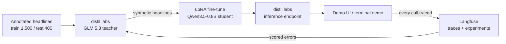

# News Gate

A 0.8B-parameter model that reads a stock headline, names the event type and decides whether it is a real shock or just noise.

**Live demo: https://news-gate.vercel.app**

## Why

A market news feed produces tens of thousands of headlines, and almost all of them are noise: price chatter, opinion, macro commentary.
A trading system only needs to react to the few that change a company's fundamentals: earnings, mergers, legal or regulatory action, management changes.
Keyword rules miss most of them, and sending every headline to a frontier model is slow and expensive.
News Gate is a fine-tuned Qwen3.5-0.8B that sorts each headline into one of 10 event types in a single short call, then maps the type to shock or noise.

Shock means `earnings`, `m_and_a`, `legal_regulatory` or `management_change`.
Noise means `analyst_rating`, `dividend`, `company_news`, `stock_movement`, `macro_market` or `other`.

## Results

Exact event-type match on the same 400 held-out test headlines (10 labels, 40 each, never trained on):

| Model | Exact match | Shock vs. noise |
| --- | --- | --- |
| Keyword rules | 30.5 % | |
| Qwen3.5-0.8B, untuned | 55.75 % | |
| GLM 5.3 (teacher) | 79.25 % | |
| **News Gate v1** - Qwen3.5-0.8B + LoRA, 1,500 annotated headlines | **88.0 %** (88.5 % in the live Langfuse experiment) | **94.8 %** (95.0 % in Langfuse) |
| **News Gate v2** - v1 data + 1,022 teacher-generated synthetic headlines | **90.5 %** | |

The fine-tuned student beats its own teacher by about 9 points on this task.
v1 training: LoRA rank 64, 2 epochs, batch size 8, learning rate 1e-4.
That was about 6.6 minutes of GPU training inside a distil labs job of roughly 35 minutes end to end.
Per-label accuracy, the confusion matrix and example errors are on the Results page of the demo and in `ui/data/`.

## How it works



1. **Data.** Headlines and tweets from a public dataset are mapped to 10 event types, deduplicated and split into a label-balanced training set and a fixed test set.
2. **Teacher and synthetic data.** distil labs evaluates the GLM 5.3 teacher on the test set, and a teacher model generates new labeled headlines around the seed data (for v2, GLM 5.3 Flash generated 1,022 of them).
3. **Student.** distil labs fine-tunes Qwen3.5-0.8B with LoRA on the seed data (v1) or seed plus synthetic data (v2) and evaluates it on the held-out test set.
4. **Deployment.** The trained student is served from an OpenAI-compatible distil labs inference endpoint, with thinking disabled and the training system prompt.
5. **Loop.** Every call from the UI is traced in Langfuse, and a Langfuse experiment scores the deployed model with `exact_match` and `shock_vs_noise` evaluators. Misclassified headlines can be exported as training rows for the next version.

## Repository

| Folder | Contents |
| --- | --- |
| [`pairs_signal/`](pairs_signal/) | Data pipeline: dataset download and label mapping, the fixed train/val/test sets, the distil labs dataset folders, Langfuse dataset upload and experiments, and the error export for the next version. Its README (German) documents sources, licenses and label mapping. |
| [`training/`](training/) | The distil labs job configs, deploy scripts, the v1 test predictions, the v2 synthetic training set and the Langfuse experiment script, with the order everything ran in. |
| [`ui/`](ui/) | The demo: a single-page UI (classify, results, "beat the model" game), Python API functions shared by a local server and Vercel, and a terminal demo with error analysis. |
| [`pitch/`](pitch/) | The 3 slides, the 60-second script, the demo runbook and the jury Q&A. |

## Run it locally

Requires [uv](https://docs.astral.sh/uv/).

```bash
uv run ui/server.py                    # http://localhost:8000
uv run ui/terminal_demo.py --n 25      # live classification in the terminal, then an error analysis
```

Without a model endpoint both run in mock mode (keyword rules, clearly marked), so the page always works.
To use a real model, set `MODEL_BASE_URL`, `MODEL_API_KEY` and `MODEL_NAME` for any OpenAI-compatible endpoint serving the trained student, and optionally `LANGFUSE_PUBLIC_KEY`, `LANGFUSE_SECRET_KEY` and `LANGFUSE_HOST` for tracing.
See [`ui/README.md`](ui/README.md) for side-by-side v1/v2 setup and the Vercel deployment.

The pipeline tests run with `cd pairs_signal && uv run pytest`.

## Data provenance

The event-type data comes from the public Hugging Face dataset [zeroshot/twitter-financial-news-topic](https://huggingface.co/datasets/zeroshot/twitter-financial-news-topic) (MIT license, about 21,000 financial news tweets and headlines).
Its topic labels were assigned by the dataset author; they are annotated labels, not labels we verified by hand, and some test rows are arguably ambiguous.
How the 20 source topics map to our 10 event types, and the other datasets that were considered, is documented in [`pairs_signal/README.md`](pairs_signal/README.md).

## Honest note

News Gate was built in one evening at the GTC Berlin Builders Night hackathon by distil labs, Langfuse and Runpod (2026-10-19).
The numbers above are single runs on one fixed 400-headline test set, not a tuned benchmark, and the code is hackathon code.
